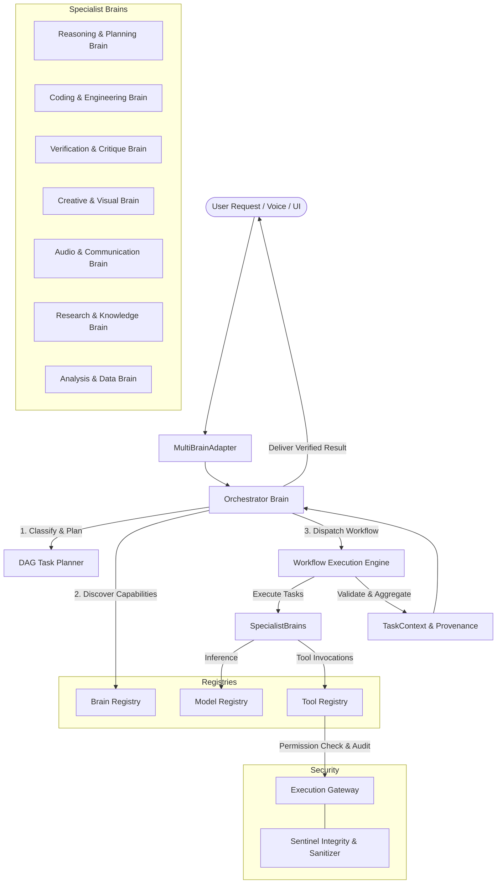

# MIND Modular Multi-Brain Architecture

The **Modular Multi-Brain Architecture** is MIND's coordinating core for specialized AI intelligence across domains. It decouples high-level task planning and domain responsibilities from underlying model engines and tool execution gateways.

---

## 1. Architectural Overview



---

## 2. Component Responsibilities

| Component | Responsibility |
| :--- | :--- |
| **Orchestrator Brain** | Classifies incoming requests, generates structured DAG execution plans, selects suitable registered brains, and synthesizes final verified results. |
| **Brain Registry** | Manages registration, capability discovery, duplicate prevention, and availability checks for all specialist brains. |
| **Model Registry** | Decouples brains from inference engines. Manages local models (Ollama: `qwen2.5-coder:7b`, `gemma3:1b`), cloud providers (LiteLLM: Groq, SiliconFlow, Cerebras), and deterministic fallbacks. |
| **Tool Registry** | Exposes declared input/output schemas, permission tiers (`SAFE`, `LOW_RISK`, `REQUIRES_APPROVAL`, `CRITICAL`), and handlers. |
| **Execution Gateway** | Central policy enforcement point: enforces permission tiers, Sentinel input sanitization, workspace path isolation, secret redaction, and audit logging. |
| **Workflow Engine** | Executes task DAGs with cycle detection, bounded parallel execution of independent tasks (`ThreadPoolExecutor`), context passing, and bounded retries. |
| **Specialist Brains** | Domain-specific agents: Reasoning/Planning, Coding/Engineering, Verification/Critique, Creative/Visual, Audio/Communication, Research/Knowledge, Analysis/Data. |

---

## 3. Difference Between Brains, Models, and Tools

- **Brain:** A specialist domain responsibility (e.g., Coding & Engineering, Verification & Critique). A brain understands domain goals, decides what steps to take, and processes domain deliverables.
- **Model:** An underlying inference engine (e.g., Ollama `qwen2.5-coder:7b`, Groq `llama-3.3-70b`, Cerebras). Multiple brains may share the same model, and a brain can select different models based on availability.
- **Tool:** A concrete utility with schema and side effects (e.g., AST syntax checker, file reader/writer, calculator, test runner). All tools execute exclusively through the Execution Gateway.

---

## 4. How to Add a New Specialist Brain

To add a new specialist domain (e.g., `RoboticsBrain` or `GameDevBrain`):

1. **Subclass `SpecialistBrain`**:
   ```python
   from multi_brain.brains.base import SpecialistBrain
   from multi_brain.contracts import Capability, PermissionTier, TaskRequest, TaskResult, TaskStatus, Provenance

   class GameDevBrain(SpecialistBrain):
       def __init__(self, model_registry=None, tool_registry=None):
           super().__init__(
               brain_id="gamedev_specialist",
               name="Game Development Brain",
               domain="Game Engineering",
               description="Generates game mechanics, shaders, and scene graphs.",
               capabilities=[
                   Capability(
                       name="generate_mechanic",
                       domain="GameDev",
                       description="Produces game mechanic logic.",
                       modalities=["code", "text"],
                       permission_tier=PermissionTier.SAFE,
                       is_available=True,
                   )
               ],
               permission_tier=PermissionTier.SAFE,
           )

       def _execute_task(self, request: TaskRequest) -> TaskResult:
           # Domain logic here
           return TaskResult(
               task_id=request.task_id,
               status=TaskStatus.COMPLETED,
               output={"mechanic": "jump_controller"},
               provenance=Provenance(brain_id=self.brain_id, confidence=0.9),
           )
   ```

2. **Register it in the Brain Registry**:
   ```python
   brain_registry.register(GameDevBrain(model_registry=model_registry, tool_registry=tool_registry))
   ```

The Orchestrator will automatically discover it by capability name or domain without modifying the Orchestrator code!

---

## 5. How to Register a New Model Provider

1. **Define a `ModelDescriptor`**:
   ```python
   from multi_brain.registries.model_registry import ModelDescriptor, ModelModality

   descriptor = ModelDescriptor(
       model_id="deepseek-local",
       provider="ollama",
       canonical_name="ollama/deepseek-r1:14b",
       modalities=[ModelModality.TEXT, ModelModality.CODE],
       is_local=True,
       context_window=32768,
       supports_tools=True,
       api_base="http://localhost:11434",
   )
   model_registry.register(descriptor, set_as_default_for=[ModelModality.CODE])
   ```

---

## 6. How to Add a Tool or Service Safely

1. **Define the tool with permission tier**:
   ```python
   from multi_brain.registries.tool_registry import ToolDefinition
   from multi_brain.contracts import PermissionTier

   def my_backup_handler(params: dict) -> dict:
       path = params.get("path")
       # Execution logic
       return {"backed_up": True, "path": path}

   tool = ToolDefinition(
       name="workspace_backup",
       description="Creates a compressed archive of a project directory.",
       handler=my_backup_handler,
       input_schema={"path": "str"},
       output_schema={"backed_up": "bool"},
       permission_tier=PermissionTier.REQUIRES_APPROVAL,
       is_available=True,
   )
   tool_registry.register(tool)
   ```
2. The tool can only be run via `tool_registry.execute_tool(...)`, which forces authorization through `ExecutionGateway`.

---

## 7. Supported Capabilities and Status

| Capability / Brain | Implemented | Status | Provider Details |
| :--- | :---: | :--- | :--- |
| **Reasoning & Planning Brain** | Yes | Active | ModelRegistry (Ollama / Deterministic) |
| **Coding & Engineering Brain** | Yes | Active | ModelRegistry (`qwen2.5-coder:7b`) + AST verification tool |
| **Verification & Critique Brain** | Yes | Active | Deterministic AST parser, artifact existence check, assertion tests |
| **Creative & Visual Brain** | Yes | Active (Honest Reporting) | Concept briefs active; image generation reports unavailable if API keys unset |
| **Audio & Communication Brain** | Yes | Active | Connects to MIND `speech_queue` / voice bot |
| **Research & Knowledge Brain** | Yes | Active | Structured factual research with source tracking |
| **Analysis & Data Brain** | Yes | Active | Numeric statistics (mean/stdev/median) + safe `math_calculator` |

---

## 8. Running the Tests

To run the complete MIND verification suite (from the repository root):

```powershell
$env:PYTHONIOENCODING="utf-8"
python -m pytest
```
