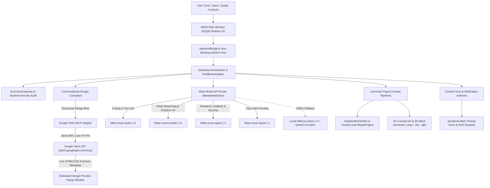

# MIND — Mageepan's Intelligence Network Device
### Meta Global AI Developer Hackathon Edition

[](https://www.python.org/)
[](https://llama.developer.meta.com/)
[](https://stitch.googleapis.com/mcp)
[](https://pypi.org/project/PyQt6/)
[](LICENSE)

---

## 1. Project Overview

**MIND (Mageepan's Intelligence Network Device)** is an AI-powered general-purpose desktop environment and multi-agent operating workspace built for the **Meta Global AI Developer Hackathon**.

Inspired by JARVIS-style interactive command centers, MIND unifies **Meta's frontier AI models** (`muse-spark-1.3`, `muse-wonder-1.0`, `muse-spark-1.2`, and `muse-spark-1.1`), **Google Stitch live UI/UX design generation**, local offline **Llama (Ollama)** inference, and specialized execution pipelines into a single cohesive desktop application.

### What Problem MIND Solves
Modern AI workflows fragment across browser tabs: one tool for reasoning and architecture, another for UI/UX mockups, another for coding and debugging, and separate utilities for 2D/3D asset creation. **MIND** eliminates context switching by providing a unified desktop workspace where specialized AI brains collaborate under a central orchestrator, security gateway, and voice notification authority.

### Who It Is For
- **Software Engineers & Full-Stack Developers** building web apps, backend APIs, desktop tools, and interactive applications.
- **Product Designers & Rapid Prototypers** generating, previewing, and iteratively revising live HTML/CSS/JS interfaces via conversational discovery and Google Stitch.
- **Technical Artists & Indie Creators** synthesizing 2D concept art and converting concepts into 3D meshes (`.obj` / `.glb`) and interactive game prototypes.

---

## 2. Core Capabilities

### 2.1 Multi-Brain Agent Architecture Powered by Meta AI Models
MIND routes every user request through a capability-aware **Modular Multi-Brain Architecture** (`MIND_Code/multi_brain`). Each specialist brain is mapped to the optimal Meta AI model tier:

| Specialist Brain / Agent | Assigned Meta AI Model | Core Responsibility |
| :--- | :--- | :--- |
| **CodingBrain** (`coding_brain`) | `muse-spark-1.3` | 1M-context code generation, AST validation, debugging, and closed-loop repair |
| **ReasoningBrain** (`reasoning_brain`) | `muse-wonder-1.0` | Deep multi-step planning, system architecture, and logical verification |
| **CreativeBrain & Design Consultant** | `muse-wonder-1.0` | Visual direction, UX consultation, and 3D character prompt synthesis |
| **ResearchBrain** (`research_brain`) | `muse-spark-1.2` | Multi-source synthesis, document reading, and evidence-backed research |
| **AnalysisBrain** (`analysis_brain`) | `muse-spark-1.2` | Quantitative evaluation, telemetry diagnostics, and security auditing |
| **Orchestrator & Manager Brain** | `muse-spark-1.1` | Low-latency intent classification, task routing, and conversational triage |
| **THEORIST / Local Fallback** | `llama3.2:1b` / `qwen2.5-coder:7b` | Private offline execution via local Ollama when cloud connectivity is unavailable |

### 2.2 Conversational Design Consultant
Before invoking expensive design generation on ambiguous prompts (e.g., *"Design a modern school website"*), MIND's **Design Consultant** identifies missing product context, presents tailored archetype options with clear design directions, and synthesizes a structured design brief. Explicit, detailed requests bypass clarification and proceed directly to generation.

### 2.3 Google Stitch Live UI/UX & Website Generation
MIND integrates directly with the **Google Stitch MCP API** (`https://stitch.googleapis.com/mcp`) as its dedicated UI/UX design engine:
- Phased request lifecycle with independent connection, generation, descriptor, and asset download timeouts.
- Automatic project recovery: if a long-running Stitch generation times out over HTTP while finishing on the server, MIND queries recent screens in the Stitch project to recover the completed design before surfacing an error.
- Strict authenticity policy: MIND never fabricates a silent substitute website if Stitch is unconfigured or unreachable.

### 2.4 Dedicated Design Preview Popup Window
Generated UI designs and interactive prototypes open in a dedicated, resizable **Design Preview Popup Window** (`DesignPreviewPopupWindow`) rather than crowding the main chat interface:
- Live HTML/CSS/JS rendering via `QWebEngineView` (with automatic local browser and rich HTML preview fallback).
- Interactive device viewport switcher (**Desktop**, **Tablet**, **Mobile**).
- Revision history selector (`v1`, `v2`, ...) allowing instant comparison across iterative design updates.
- One-click **Approve & Build Project**, **Request Revision**, **Open in Browser**, and **Reopen Preview** controls.

### 2.5 Universal Software & Application Studio
Beyond websites, MIND scaffolds, verifies, and repairs full project workspaces (`MIND_GameDev/workspace/<project_slug>`):
- **Web Applications & REST APIs** (FastAPI, HTML5/CSS3/JS)
- **Desktop GUI Applications** (PyQt6 / Python)
- **Automation Scripts & CLI Utilities**
- **Interactive 2D/3D Games & Prototypes** with automated syntax/contract verification (`IndependentVerifier`) and closed-loop AI self-repair (`RepairEngine`).

### 2.6 2D Concept Art & Image-to-3D Asset Pipeline
- Generates verified 2D concept art (via cloud APIs or local Pillow procedural synthesis).
- Converts 2D concepts into validated 3D polygonal meshes (`.obj` / `.glb`) via Tripo3D or MIND's local geometric mesh engine, complete with provenance manifests (`asset_registry.json`).

### 2.7 Concurrent Multitasking & Central Voice Notification Authority
- **Non-Blocking Worker Pool**: Run multiple heavy tasks (e.g., Stitch website generation + Python coding task + 3D asset synthesis) concurrently without freezing the PyQt6 UI.
- **Central Voice & Notification Authority**: Eliminates overlapping speech synthesis (`QBasicTimer` cross-thread hazards prevented via main-thread Qt signal dispatch), deduplicates alerts, and speaks concise milestone summaries.

---

## 3. System Architecture



---

## 4. Repository Structure

```text
MIND-Meta_Hackathon_demo/
├── run_hackathon_app.py              # Primary Desktop GUI Application Launcher
├── start_mind.bat                    # One-click Windows batch launcher
├── requirements.txt                  # Verified Python package dependencies
├── pytest.ini                        # Automated test suite configuration
├── .env.example                      # Sanitized environment variable template
├── .gitignore                        # Strict credential, cache, and artifact exclusions
├── LICENSE                           # MIT License
├── README.md                         # Complete setup, architecture, and usage guide
│
├── MIND_GameDev/                     # Desktop UI, Studio Workflows, Adapters & Tests
│   ├── app.py                        # CLI interactive entrypoint
│   ├── config.py                     # Portable environment & workspace configuration
│   ├── models.py                     # Specifications, contracts, and data structures
│   ├── orchestrator.py               # Central command, design, and studio orchestrator
│   ├── providers.py                  # Provider health and capability diagnostics
│   ├── adapters/                     # Meta AI coding, Google Stitch, Voice, 2D/3D adapters
│   ├── agents/                       # Specialized Planning, Coding, Verification & Repair agents
│   ├── game_workflows/               # Website, Web App, Backend API, Desktop, Game & Repair engines
│   ├── tools/                        # Design Consultant, Preview Server, Verifier, Session Memory
│   ├── ui/                           # PyQt6 Main Window, Circular AI Core, Views & Popup Preview
│   └── tests/                        # 206 automated unit, integration, and workflow tests
│
└── MIND_Code/                        # Multi-Brain Cognitive Engine & Meta Provider Layer
    ├── config.py                     # Core system paths and runtime signals
    ├── mind_brain.py                 # Persona router, memory RAG, and brain dispatcher
    ├── modules/                      # SQLite WAL MemoryAgent, Personas, Sentinel, Meta-Reasoning
    └── multi_brain/                  # Modular Multi-Brain Architecture
        ├── adapter.py                # Unified Multi-Brain orchestration adapter
        ├── contracts.py              # TaskRequest, TaskResult, Provenance & Permission contracts
        ├── brains/                   # 9 Specialist Brains (Coding, Reasoning, Research, etc.)
        ├── design/                   # Design intelligence, layout engine & evaluators
        ├── orchestrator/             # DAG planner, classifier, and lifecycle manager
        ├── pipeline/                 # 6-Stage AI Concept-to-3D Asset Generation Pipeline
        ├── providers/                # Official MetaModelClient (meta_provider.py) & local providers
        ├── registries/               # Model, Provider, Brain, Tool & Capability registries
        ├── security/                 # ExecutionGateway & secret-redacting audit log
        ├── stitch/                   # Multi-Brain Stitch MCP client
        ├── voice/                    # CentralVoiceNotificationAuthority & queue controller
        └── workflow/                 # Bounded-parallelism DAG execution engine
```

---

## 5. System Requirements

- **Operating System**: Windows 10 or Windows 11 (64-bit recommended; Linux/macOS supported for CLI and core PyQt6 views)
- **Python**: Python **3.11** or **3.12** (64-bit)
- **Memory**: Minimum 8 GB RAM (16 GB recommended when running local Ollama models)
- **Disk Space**: ~800 MB for Python virtual environment and dependencies
- **Network**: Internet connection required for **Meta AI Model API** (`https://api.meta.ai/v1`) and **Google Stitch MCP** (`https://stitch.googleapis.com/mcp`)
- **Optional Local Tools**:
  - [Ollama](https://ollama.com/) (optional, for offline local Llama fallback)
  - [Blender 3.6+](https://www.blender.org/) (optional, for headless `.blend` / `.fbx` export)
  - Microphone & Speakers (optional, for voice interaction)

---

## 6. Step-by-Step Installation Instructions (Windows PowerShell)

Open **Windows PowerShell** and run the following commands to clone and set up MIND in a clean virtual environment:

```powershell
# 1. Clone the repository
git clone https://github.com/Makeepan-dev/MIND-Meta_Hackathon_demo.git
cd MIND-Meta_Hackathon_demo

# 2. Create an isolated Python virtual environment
python -m venv .venv

# 3. Activate the virtual environment
.\.venv\Scripts\Activate.ps1

# 4. Upgrade pip and install all required dependencies
python -m pip install --upgrade pip
pip install -r requirements.txt
```

> **Note on PowerShell Execution Policy:** If `Activate.ps1` is blocked by Windows PowerShell policy, run:
> ```powershell
> Set-ExecutionPolicy -ExecutionPolicy RemoteSigned -Scope CurrentUser
> ```
> Or invoke Python directly via `.\.venv\Scripts\python.exe`.

---

## 7. Essential API Key Configuration (`.env`)

MIND reads all credentials from a local `.env` file in the repository root. **Never commit `.env` to Git.**

### Step 1: Create your `.env` file from the template

```powershell
Copy-Item .env.example .env
notepad .env
```

### Step 2: Configure your API keys in `.env`

```dotenv
# Primary AI Engine — Official Meta AI Model API
MODEL_API_KEY=your_meta_model_api_key_here
META_API_KEY=your_meta_model_api_key_here
META_API_BASE=https://api.meta.ai/v1

# Meta AI Model Assignments
META_CODING_MODEL=muse-spark-1.3
META_REASONING_MODEL=muse-wonder-1.0
META_ANALYSIS_MODEL=muse-spark-1.2
META_FAST_MODEL=muse-spark-1.1

# Google Stitch UI/UX & Website Design Generation
STITCH_API_KEY=your_google_stitch_api_key_here
STITCH_MCP_URL=https://stitch.googleapis.com/mcp
```

### Environment Variable Reference

| Variable Name | Required? | Default / Endpoint | Purpose | Behavior When Missing |
| :--- | :---: | :--- | :--- | :--- |
| `MODEL_API_KEY` / `META_API_KEY` | **Required** (for Cloud AI) | `https://api.meta.ai/v1` | Authenticates all specialist brains with the official Meta AI Model API (`muse-spark-*`, `muse-wonder-*`). | Cloud Meta brains report unconfigured status and automatically fall back to local Ollama (if running) or deterministic local scaffolding. |
| `META_API_BASE` | Optional | `https://api.meta.ai/v1` | Base URL for the Meta AI OpenAI-compatible chat completions endpoint. | Defaults to `https://api.meta.ai/v1`. |
| `META_CODING_MODEL` | Optional | `muse-spark-1.3` | Model used by `CodingBrain`, `CodingAdapter`, and `RepairEngine`. | Defaults to `muse-spark-1.3`. |
| `META_REASONING_MODEL` | Optional | `muse-wonder-1.0` | Model used by `ReasoningBrain`, `CREATIVE`, and `PromptSynthesizer`. | Defaults to `muse-wonder-1.0`. |
| `META_ANALYSIS_MODEL` | Optional | `muse-spark-1.2` | Model used by `AnalysisBrain`, `ResearchBrain`, and `SECURITY`. | Defaults to `muse-spark-1.2`. |
| `META_FAST_MODEL` | Optional | `muse-spark-1.1` | Low-latency model used by `MANAGER` and intent classification. | Defaults to `muse-spark-1.1`. |
| `STITCH_API_KEY` | **Required** (for Live Website Design) | `https://stitch.googleapis.com/mcp` | Authenticates MIND with Google Stitch MCP for live UI/UX and HTML screen generation. | MIND displays a clear configuration diagnostic in chat and does **not** fabricate a fake Stitch website. |
| `OLLAMA_API_BASE` | Optional | `http://localhost:11434` | Local Ollama server URL for offline Llama inference (`THEORIST` brain & fallback). | Offline fallback is skipped if Ollama is not running locally. |
| `TRIPO_API_KEY` | Optional | `https://api.tripo3d.ai/v2/openapi` | Cloud Image-to-3D generation API key. | Automatically falls back to MIND's local procedural Wavefront `.obj` / `.glb` mesh generator. |
| `MIND_VOICE_OUTPUT` | Optional | `1` (Enabled) | Enables or disables spoken TTS responses (`1` = on, `0` = silent). | Defaults to `1`. |

---

## 8. Running MIND

### Option A: Launch the Full Desktop GUI (Recommended)

From an activated virtual environment in the repository root:

```powershell
python run_hackathon_app.py
```

Or double-click / run the Windows launcher script:

```powershell
.\start_mind.bat
```

**What You Should See on Launch:**
1. The **MIND — Mageepan's Intelligence Network Device // Meta Hackathon Edition** desktop window opens (`1280x820`) with the dark cybernetic command theme.
2. The left navigation rail provides instant access to:
   - **Unified Assistant** (Multi-Brain Chat, JARVIS Circular AI Core, Active Tasks Drawer, and Design Consultant)
   - **Command Overview** (System telemetry & quick actions)
   - **Creation Studio** (Project workspace browser, 2D/3D asset pipeline, and code inspector)
   - **AI Brains & Models** (Live status of Meta AI models, Google Stitch, and local Ollama providers)
   - **Voice & Audio** (Central Voice Notification Authority & microphone controls)
   - **Activity Log**, **Verification Evidence**, and **Settings**.

### Option B: Launch the Interactive CLI Studio

```powershell
python -m MIND_GameDev.app
```

---

## 9. Usage Guide

### 9.1 General AI Assistant & Multi-Brain Chat
In the **Unified Assistant** view, type any software engineering, architecture, math, security, or research question:
- *"Design a scalable microservices event bus in Python with retry dead-letter queues."* -> Routed to **CodingBrain (`muse-spark-1.3`)**.
- *"Compare dialectical trade-offs between optimistic concurrency and distributed locks."* -> Routed to **ReasoningBrain (`muse-wonder-1.0`)**.

### 9.2 Designing a Website with Conversational Discovery & Google Stitch
1. **Ambiguous Request (Discovery Mode)**:
   - Type: `"Design a modern school website"`
   - MIND's **Design Consultant** responds with tailored interactive cards (e.g., *K-12 Academy*, *University / Higher Education*, *Coding & Technical Academy*, *Elementary School*) explaining the visual direction and target audience for each.
   - Click an option card (or type custom preferences such as *"Coding school with a dark cyberpunk theme and course catalog"*).
2. **Direct Detailed Request**:
   - Type: `"Design a modern fintech analytics landing page with dark glassmorphism, pricing tiers, and live KPI hero cards"`
   - MIND sends the structured design specification directly to **Google Stitch MCP** (`generate_screen_from_text`).

### 9.3 Reviewing, Revising & Approving Designs in the Popup Preview Window
- Once Google Stitch returns the generated HTML/CSS screen, MIND automatically opens the **Dedicated Design Preview Popup Window** and starts a local preview server.
- Use the popup toolbar to:
  - Switch between **Desktop**, **Tablet**, and **Mobile** viewports.
  - Type iterative changes in chat or the revision bar (e.g., `"Change the hero background to deep emerald and add a testimonials section"`) — Stitch updates the screen and increments the version (`v1` -> `v2`).
  - Click **Approve Design** to export and scaffold the approved design into a full working project under `MIND_GameDev/workspace/`.
  - If you close the popup window, click **Reopen Design Preview** in the chat header at any time to restore the current session design without regenerating it.

### 9.4 Generating 2D Concept Art & 3D Models
- Type: `"Generate a 3D model of a futuristic cybernetic guardian robot"`
- MIND synthesizes a 3D-ready concept prompt via `muse-wonder-1.0`, renders a validated 2D concept image (`.png`), and reconstructs a 3D mesh (`.obj` / `.glb`) stored with full provenance metadata.

### 9.5 Running Concurrent Tasks
- Submit multiple prompts in parallel without waiting for long-running operations to finish. The **Active Tasks** panel tracks live progress bars and elapsed timers for each concurrent worker.

---

## 10. Running the Automated Verification Suite

MIND includes **206 automated tests** covering the Meta AI model migration, Google Stitch direct preview and timeout recovery, conversational design discovery, popup preview lifecycle, multitasking concurrency, voice notification authority, and workspace safety.

Run the complete test suite from the repository root:

```powershell
pytest
```

Or run specific verification suites:

```powershell
# Verify Meta AI Model API migration, routing, and Google Stitch preservation
pytest MIND_GameDev/tests/test_meta_model_migration.py

# Verify Google Stitch direct-to-popup preview and timeout recovery
pytest MIND_GameDev/tests/test_stitch_direct_preview.py MIND_GameDev/tests/test_stitch_timeout_and_recovery.py

# Verify Conversational Design Consultant discovery flow
pytest MIND_GameDev/tests/test_conversational_design_discovery.py
```

---

## 11. Troubleshooting

| Issue / Symptom | Cause | Resolution |
| :--- | :--- | :--- |
| **`API key for Meta Model API is not configured`** | `.env` file is missing or `MODEL_API_KEY` / `META_API_KEY` still contains `your_meta_model_api_key_here`. | Copy `.env.example` to `.env` and set `MODEL_API_KEY` and `META_API_KEY` to your valid Meta AI Model API key. |
| **`Google Stitch API key (STITCH_API_KEY) is not configured`** | `STITCH_API_KEY` is unset in `.env`. | Add your Google Stitch API key to `STITCH_API_KEY` in `.env` and restart MIND. |
| **`Google Stitch request 'generate_screen_from_text' timed out after 180.0s`** | Complex UI generation took longer than the default HTTP read timeout. | MIND automatically attempts to recover completed screens from the Stitch project. You can also increase `STITCH_GENERATE_TIMEOUT=240` in `.env` or click Retry with a more focused prompt. |
| **`ImportError: cannot import name 'QWebEngineView'`** | `PyQt6-WebEngine` is not installed in the active Python environment. | Run `pip install PyQt6-WebEngine>=6.6.0`. MIND also includes an automatic fallback preview widget and external browser launcher if WebEngine is absent. |
| **No spoken audio output** | Windows TTS voices or audio output device unavailable, or `MIND_VOICE_OUTPUT=0`. | Ensure `MIND_VOICE_OUTPUT=1` in `.env` and verify a default playback device is active in Windows Sound Settings. |

---

## 12. Known Limitations

1. **Cloud API Credentials Required for Live Frontier Inference**: Live Meta AI model inference (`muse-spark-1.3`, `muse-wonder-1.0`, `muse-spark-1.2`, `muse-spark-1.1`) and live Google Stitch design generation require valid user-supplied API keys in `.env`.
2. **Google Stitch Generation Latency**: Generating complete multi-section UI screens via Google Stitch typically takes **20–90 seconds** depending on prompt complexity and cloud load.
3. **Optional External 3D Tooling**: Full `.blend` scene execution requires a local installation of Blender (`BLENDER_EXECUTABLE` in `.env`), though Wavefront `.obj` and binary `.glb` meshes are generated natively without external software.

---

## 13. Meta Global AI Developer Hackathon Information

This edition of **MIND** was engineered specifically for the **Meta Global AI Developer Hackathon**:
- **Complete Agent Ecosystem Migration to Meta AI**: All cognitive, coding, reasoning, research, analysis, creative prompt synthesis, and orchestration agents operate on Meta's Model API (`muse-spark-1.3`, `muse-wonder-1.0`, `muse-spark-1.2`, and `muse-spark-1.1`) with unified token/credit telemetry and rate-limit resilience (`MIND_Code/multi_brain/providers/meta_provider.py`).
- **Hybrid Best-of-Breed Design Workflow**: Combines Meta's reasoning models (`muse-wonder-1.0` / `muse-spark-1.1`) for interactive design requirement discovery with **Google Stitch MCP** for live HTML/CSS UI generation inside MIND's dedicated popup preview window.
- **Local Llama Continuity**: Supports seamless offline fallback to local **Meta Llama** models (`llama3.2:1b`) via Ollama so the system remains functional in offline or air-gapped environments.

---

## 14. License & Acknowledgements

- **Author**: Makeepan Thanarasa ([Makeepan-dev](https://github.com/Makeepan-dev))
- **License**: Released under the [MIT License](LICENSE).
- **Acknowledgements**: Built with the **Meta AI Model API**, **Google Stitch MCP**, **PyQt6**, and **Ollama**.
